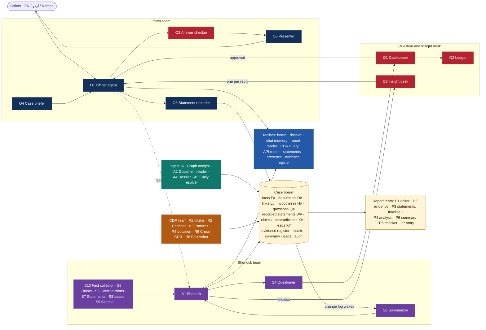
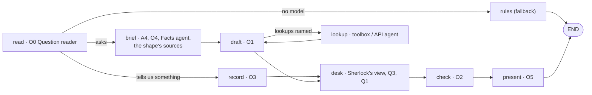
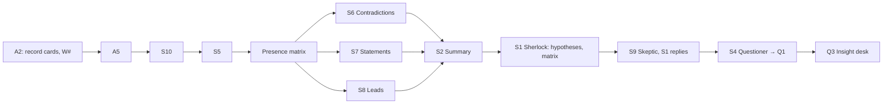
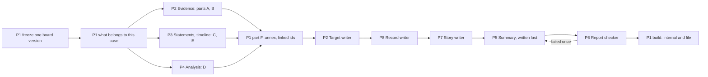

# Sherlock: how the agents work together

Two teams share one **case board**. The **Officer team** talks to the officer and makes
sure every question gets a correct answer. The **Sherlock team** works the case in the
background. The **Question desk** sits between them, so a question is never asked twice and
every answer the officer gives reaches Sherlock. The **Ingest team** and the **CDR team**
fill the board; the **shared toolbox** finds information for both teams and never guesses.

The design, with its reasons, is in `docs/sherlock-agent-plan.html`; its section "What
changed in v6" has the current diagram of one question, one background run and one report.

**Orchestration: LangGraph** (`src/sherlocks/team/`). Each team is one compiled graph:
`team/officer_graph.py` is a chat turn, `team/sherlock_graph.py` is one background run,
`team/report_graph.py` writes the case report. The
nodes are the agents; the edges are fixed in code or follow the model's own reading - never
words matched in the officer's message. The case board is the only memory: a graph's state
just carries the turn (or the run) to its nodes. LangSmith tracing is switched off in
`team/runtime.py`: nothing about a case leaves the police network.

**Who understands language.** Every agent that has to understand what someone wrote - the
officer's message, a record, a statement - asks the model with a typed schema. Code stores,
compares structured values (dates within a tolerance, identifiers, counts, quotes that must
be in their source) and guards. The keyword rules are one node (`rules`) of the Officer
graph, used only when there is no model to read with.

## The new case

The target is searched to learn who he is involved with; the case being worked is a
**new** one - the incident the officer describes (what, where, when, the FIR once there is
one). Previous FIRs, his and his associates', are background: `linkgraph/relevance.py`
says how each bears on the new case (same kind of crime, same area, people linked to the
target, recent), and the FIR answers, Sherlock and the summary all say it. "This case" in
a question means the new case once it is described.

## The new case and the past records

The case being worked is what the **officer describes** (`case.incident`) - not the FIRs
already on file. Three situations, and only the officer can say which:

1. the target has no earlier record - a suspect in a new matter;
2. the target has earlier cases - they are his history; he is a suspect in a new matter;
3. the case IS an FIR already on file in which the target is accused and was arrested -
   then that FIR, and only that FIR, describes this case.

So when an FIR is on file and the officer has not said, Sherlock's first question (red) is
**which case this is** (`case:which`). The recorder notes the answer (`this_case`,
`this_case_fir`, `target_in_custody` -> `case.dialog["case_basis"]`, `incident.fir`,
`incident.target_status`). Every agent is given `the_new_case` (`relevance.the_new_case`)
and the rule `runtime.NEW_CASE`: a past FIR's date, place, offence or people are never
given as the new case's; while the officer has not said, the target is "the target", not
"the accused", and nobody is said to be arrested. Asked about "this case" before it is
described, the reply says so, names the FIRs on file as past records, and asks.

**Telling the three situations apart.** With no record on the target, Sherlock asks what
happened, where and when. With a record, the first question names the target's recent
crimes (FIR number, police station, offence, role, the register it comes from - latest
first, `questioner.recent_crimes`) and asks: *are you investigating him for one of these
same crimes - and was he arrested in it - or is this a new matter?* "New matter" keeps the
record as history. "The same case as FIR X" makes that FIR this case's own: its offence,
date, time and place are taken from the FIR file (`recorder.adopt_fir`, marked
`incident.from_fir`) and are not asked again. One target is never asked "who is the main
suspect?" - entering him said so.

## What each police system tells

`linkgraph/systems.MEANING` says, for every system, what its record is and how a link from
it reads (taken from the shape of each API's answer, which `extractors.py` parses): a
tenancy witness vouched for the tenant and is not a co-tenant; a registered owner of a SIM
is who the number is registered to, not always who uses it; "shared hotel stay" means the
same stay, "used the same phone at check-in" does not. The Officer agent gets the
explanation of every system in play (`what_each_system_tells`), and the **dossier** of a
person carries what each system returned about them: `records`, `hotel_stays`, `vehicles`,
`organisations`, `police_officer`, the systems searched with nothing found and the ones that
could not be checked (an error is never reported as "no record").

**The tenant register (TRUST)** answers with the person's tenancies by the part they have
in each: `tenacies_as_tenant` (with the landlord, `witness1`, `witness2` and
`family_members`), `tenacies_as_witness`, `tenacies_as_family_member` and
`properties_owned`. `extractors._trust_tenancies` reads each list for what it means, so a
link is "Tenancy witness", "Landlord", "Tenant (home the subject lives in)", "Family
member, same rented home" - never "named in property record" - and carries the property,
the landlord, the lease dates, the status and the police station. The `relation` field
beside a witness is his father's name; it is read as a relation only when it is a kinship
word. `relations.py` turns each label into its sentence ("A was witness to the tenancy of
B"). A link's label is fixed when the graph is built: older runs need a new search.

**Who a name means** (`network.resolve`): every name the records give a person counts, not
only the one shown - the exact name first, then a word of it, then the same name in the
other script, and a look-alike spelling only last ("hasnain" is not "Hassan" when someone
on the graph is called Hasnain).

## The graph: whose name, which address

Three rules of the link graph (`linkgraph/graph.py`, `linkgraph/weak_links.py`):

- **Whose name is shown.** A person's name (and father's name) comes from our own
  registers first: NADRA, then the driving licence (DLS), then the tenant registers (PRVS,
  Old Tenant, TRUST), then the other police systems. The telecom **subscriber API** comes
  after all of them, name tags and the open web last (`graph.NAME_PRIORITY`). Other
  spellings are kept as "also recorded as".
- **The same address means the same place.** Two addresses match only on the same
  premises (house / flat / plot, street, block) or at least the same named locality
  (mohalla, colony, village - a weaker "same locality"). The same city, district or
  province alone is never the same address, and the model saying so is not believed
  (`weak_links.address_score`).
- **Co-witnesses are co-witnesses.** People who witnessed the same tenancy, verification
  or case are linked as "both witnesses in ..."; the address written on that form does not
  make them "the same address".

## The case board

`evidence/case_file.py`. Every entry carries where it came from:

| Field | Meaning |
|---|---|
| `agent`, `event` | who wrote it, and the batch it belongs to (one upload, one CDR, one correction) |
| `tier` | `fact`, `inference` or `speculation` - how sure the claim is |
| `trust` | 1 system record · 2 document · 3 the officer · 4 derived by us · 5 unverified - who it comes from (`evidence/trust.py`) |
| `rests_on` | ids and topics it was built from (`F12`, `incident:date`, `owner:D9`) - what a correction follows |
| `replaces` / `replaced_by` | a correction: the old entry is kept, never deleted |
| `stale` | rests on something that changed: out of answers until the agent that made it redoes it |
| `rows`, `page` | where in the file or document it is |

Rules: **add, never rewrite**; every change goes into the change log (`case.changes`)
with its agent and event; listeners are told once per batch, never for a batch still open.

Besides facts, documents and links the board holds: the incident, roles, the question
ledger, the conversation, hypotheses `H#` with their history, the summary and timeline,
ranked gaps, dossiers, Sherlock's quick views given in chat, the Question desk's decisions,
follow-up messages, the audit log of live calls and the agenda of background work.

**Where it lives** (`evidence/board_store.py`): its own table `case_board` (migration
`9c4e1a7b2d30`), keyed by run, with the board's version. A save older than the stored board
is refused; a board posted back by the host that is older than the stored one does not
replace it - only the officer's own edits in it (roles, incident) are merged as new entries.
Every caller gets the **same** board object for a run (`RunManager.board`), also after the
run has left memory. A copy stays in the run's graph (`graph.case`) for exports.

## The Officer team: one reply

`team/officer_graph.py` (entry point `linkgraph/sherlock_team.run_turn`, which streams the
graph's events to the chat):

1. **read - O0 Question reader** (`linkgraph/question_reader.py`). One model call reads the
   message: the act (question, statement, answer, correction, greeting), what is wanted, the
   people, the role asked about, the scope, the **answer shape** (FIR, person, incident,
   statement, link, phone, count, yes / no, what next), the depth (full unless the officer
   asks for short), whether Sherlock's judgment helps, and the language. **Its reading is
   the ask.** A message that asks anything is a question, even if it names someone Sherlock
   asked about. No model, or no answer from it: the turn goes to `rules`.
2. **record - O3 Statement recorder** (`team/recorder.py`), when the officer tells us
   something. The model breaks the message into entries, one fact each: who told us, the
   **original speaker** ("muddai ne bataya ke..." is two people - the entry gets the
   complainant's trust, not the officer's), about whom, what, where, **when it happened**
   ("kal raat 10 baje ke qareeb" becomes a date and time from the message time, with a
   30-minute tolerance, the officer's words kept), **how the officer knows** (saw it, a
   record, heard it, an informant, thinks so - which sets fact, inference or speculation)
   and how sure. It also says whether an entry **corrects** something on file (then
   `linkgraph/corrections.py` replaces it and marks what rests on it stale), which open
   question the message **answers** (by what the answer is; "don't know" closes it too), a
   yes / no to something Sherlock asked to confirm, and what the officer wants of the desks
   (stop asking; hold Sherlock's findings). O1 reads back in one line what was recorded.
3. **brief** - for a question: **A4 Dossier agent** (the card of each person asked about),
   the case board and graph (the knowledge base), **O4 Case briefer** (`linkgraph/briefer.py`:
   the context pack at one board version), the **Facts agent** (`linkgraph/case_queries.py`:
   exact counts and lists, computed - never left to the model to count), and every source
   the answer shape needs (`team/shapes.SOURCES`: statements, the presence matrix, the
   evidence register, contradictions, leads...). Sherlock's quick view starts alongside
   when the reading says his judgment helps (a person's involvement, why, what next) - not
   for counts, lists and lookups.
4. **draft - O1 Officer agent** (`team/officer_agent.py`). Given all of that plus the open
   contradictions and leads about the people asked, he writes the answer into the shape's
   sections, each line with its source id. **No list of question types limits what he may
   answer.** When what he was given does not hold the answer he names the **lookups** that
   would get it: any tool of the shared toolbox, with its arguments.
5. **lookup** - the graph runs those tools in parallel, inside the tools budget. The live
   ones (`api_router`, `lookup`, `fetch_fir`, `fetch_lab_reports`, `fetch_cro`,
   `cdr_lookup`) are the **API agent**: police systems and FIR files called at run time,
   through the guard, logged under the officer. What comes back goes on the board and O1
   drafts once more (two drafts at most - never a loop).
6. **desk** - nothing found anywhere: the reply says so plainly, "I did not find an answer",
   with every place checked - never a guess. A question that needs real work (O1 says
   `deeper`) is **not** investigated inside the reply: it goes on Sherlock's agenda, the
   reply says he is looking into it, and what he finds comes back through the Insight desk.
   (planning it wakes his run; his conclusion is told as a finding). Then Sherlock's view is collected, and **one extra item** is chosen: a critical finding
   from the **Insight desk** first; else the Gatekeeper's question; else another finding.
7. **check - O2 Answer checker** (the finding is checked like the answer: one that cites an
   entry not on the board is held back; a reply that still fails after one revision goes
   out with a visible "not verified" line), then **present - O5 Presenter**: the answer first, the
   shape under headings, evidence quoted, Sherlock's view in its own block, the finding
   ("Sherlock ki nayi baat (tasdeeq nahi)") after the answer, the question last.

### What the model is held to

Found by running the office model (Qwen 27B, about 60 tokens a second) on a live case:

- **Every field is asked for** (`team/runtime.Typed`). With guided decoding the model leaves
  out any field that has a default: no shape, no depth, no sections came back. Every schema
  the model fills marks its fields required in the JSON schema (a list of many small details
  asks only for the ones that matter: `runtime.asking`).
- **Code settles what the model is loose about** (`officer_agent.normalise`): a section
  with points is *filled* whatever status it was given; a source in brackets stays only
  when it is a real entry of the board or a police system whose record was given
  (`runtime.real_refs`) - an invented id or the name of a field is taken out.
- **The chat is context, never evidence.** O1 is given the conversation only to follow it;
  O2 judges a draft against the records it was written from, the text of the documents it
  cites and the officer's own words - never against Sherlock's earlier replies (which once
  "corrected" right drafts into wrong ones).
- **Plain words** (`runtime.PLAIN`, in every agent that writes for the officer): what the
  records show, never network-analysis terms (broker, gatekeeper, cluster, centrality). A
  SIM registered in another person's name is common: a fact on the board, never a lead.
  Call records never show what was said.
- **Background calls are sized to finish** inside the model's 60-second call limit: small
  batches, short outputs, at most 18 fields a record card.

### Answer shapes

`team/shapes.py`. For each kind of question, a fixed list of sections the answer must
cover - for an FIR: what happened, when, where, who, why (as stated, and by whom), weapon
and property, statements, evidence, status, contradictions and leads, not on record. Full
by default; short only when the officer asks. O1 fills each section with sources or marks
it **not on record** / **not checked yet**; a section he drops is put back, marked, and
O2 records it (`checks.rules.complete`, `checks.restored_sections`). The shapes are data:
nothing in them reads the officer's words.

**Time budgets** (`linkgraph/budget.py`, settings `chat.*`): each step has a limit and a
fallback; the whole reply never takes over 40 s. What finishes late is sent as a
**follow-up** message in the same chat (`case.followups`; the portal polls for them).

| Step | Model | Budget | Over budget |
|---|---|---|---|
| O0 Question reader | one call | - | no reading: the rules turn |
| O3 Statement recorder | one call (when the officer tells us something) | 10 s | the rules turn |
| O4 Case briefer, the shape's sources | no | - | - |
| O1 draft | one call; a second after lookups bring something | 18 s (a full shaped answer is 400-600 tokens, about 10-15 s on the office model) | a first draft that answered goes out; else the rules answer from the board now and the model's answer follows |
| Lookups / live calls | no | 10 s in all, in parallel | answer without them; what they bring is on the board for the next question |
| Sherlock's quick view | one call, alongside | 10 s | "Sherlock is looking into it"; his view follows |
| Gatekeeper's reading of the chat | one call, alongside | 4 s at the desk | nothing new is asked this turn |
| O2 model check | one call | 6 s | rules only this time |
| O1 redraft | only when the check fails: the draft goes back to O1 once, with the reasons | what is left, up to 18 s | the first draft goes out with a "not verified" line |
| O5 Presenter | no | - | - |
| Deep investigation | Sherlock, in the background | never inside the reply | his conclusion comes through the Insight desk |

Every turn records each step's time, its model calls and what ran late (`final.timing`,
`final.model_calls`, `final.late`).

**While the officer waits** the chat shows one line saying what runs now - "Searching the
case board", "Checking NADRA · Kamran Ahmed", "Sherlock is thinking it through" - in the
officer's language, as shimmering text (`conversation.STATUS`, `TOOL_STATUS`; `status`
events on `POST /graph/investigate`). Fixed text, never written by the model.

### O2 Answer checker

`sherlock_team.validate`, code first:

| Rule | Check |
|---|---|
| Answered what was asked | a count question opens with the count; the reply does not open with a question |
| Correct | numbers match the Facts agent's result |
| Sourced | every id exists and is not replaced or stale; quoted text must be in the document it cites - a quote that is not is removed |
| Consistent | nothing contradicts the officer's statements (the model is asked only for claims no query computed) |
| Honest about gaps | nothing found, and the reply says so |
| Labelled | speculation is marked as Sherlock's view |

Sources that disagree are **shown, never hidden**: the reply leads with the more trusted one
and names both (`trust.conflicts`). Exception: for the incident's time and place and for
roles, the officer's word leads over the FIR.

### O5 Presenter

`linkgraph/presenter.py`: the first line answers, in bold; three or more FIRs become a
table (only when it keeps every number the bullets had); up to two short quotes from the
records with their source (translated when the officer's language differs and a model is
connected); Sherlock's view in its own labelled block; the question last. A **format guard**
compares every number, CNIC, phone, FIR number and source id with the checked answer; if
anything changed, the checked answer goes out as it is.

### The Facts agent and the knowledge base

Exact answers by code (`linkgraph/case_queries.py`, `offences.py`, `narrate.py`):

| Query type | Example | Answer |
|---|---|---|
| `cases` / `count_cases` | "ye kitni FIRs mein?" | FIRs with number, police station, role, crime in words, source; the count |
| `fir_status` | "kis FIR mein acquitted, kis mein convicted?" | each FIR's outcome from CRO / PSRMS and the FIR file |
| `serious_cases` | "koi khatarnak FIR?" | heinous / serious crimes first; FIRs where he is the complainant said apart |
| `fir_details` | "FIR 391/26 ki tafseel" | crimes, role, complainant, date, accused, the complainant's account, status |
| `io_report` | "IO ne guilty declare kiya?" | what the investigating officer concluded (challan, A/B/C class, 169), quoted |
| `criminals_near` / `criminals_all` | "his connections mein kitne criminals?" | people with a record, with how they are linked |
| `profile`, `connection`, `associates`, `hotels`, `phones`, `vehicles`, `documents`, `graph_stats`, `news`, `summary` | | from the graph and the board, each item with its source |

Every other question is answered from the live **knowledge base** (`linkgraph/knowledge.py`):
all people, record fields, links, FIR files and diaries, documents, the officer's
statements and Sherlock's hypotheses (corrected and stale entries left out), searched by
words, concepts in three languages and sound. A question about a person returns only
entries about that person; a topic no record holds is said to be missing, never guessed.

## The Question desk

`evidence/question_desk.py`. The Questioner (`evidence/questioner.py`) and Sherlock propose;
the **Gatekeeper** decides; the **ledger** (`case.questions`) keeps every question with its
topic key, how often and in which turns it was asked, its status (`open`, `answered`,
`dont_know`, `muted`) and the answer with its turn (earlier answers kept on a correction).

| Rule | |
|---|---|
| Same topic, same question | topic keys (`incident:when`, `roles:main`, `cdr_owner:D3`); free-form questions get one from their words |
| Answered anywhere closes it | the ledger, the board, or anywhere in the chat - said in passing, the answer is taken from that turn |
| "Don't know" counts | never asked again |
| Muted | "ye mat poocho" / "don't ask that" |
| Max two asks | never in two replies in a row; one per reply; none while the officer is busy asking something else |
| Checked twice | when proposed, and again just before it is asked |
| Tells Sherlock why | every rejection is logged with the reason and the answer on file; Sherlock reads them |

| Key | Asks |
|---|---|
| `incident:place` / `incident:pin` | where it happened (map) |
| `incident:what`, `incident:when`, `incident:fir`, `incident:vehicle` | which crime, when, the FIR, a vehicle or weapon |
| `roles:main`, `roles:victim` | the main suspect, the victim |
| `cdr_owner:D#`, `cdr_of:<person>` | whose a CDR is; upload the main suspect's CDR |
| `confirm_lookup:<number>` | a number that appears only in a document: may it be looked up? |
| `confirm_lookup:cdr:D#` | may the owners of a CDR's top contacts be looked up? |
| `link:why`, `suspects:other` | what ties the targets; anyone else suspected |

## Corrections

`linkgraph/corrections.py`: incident date, time and place; a person's role (also moved from
one person to another: "Kamran nahi, Imran"); the owner of a CDR. One event: the new
statement `replaces` the old, the ledger answer changes, everything that rests on the old
statement or the topic is marked stale, and the redo goes on the agenda (CDR incident window
and towers near the pin, re-filing a CDR's findings, dossiers, summary, Sherlock). The
officer is told what changed and what is being redone.

## The shared toolbox and the API router

The investigator's tools (`linkgraph/investigator.py`), the same for both teams, each team
with its own budget: **board** reader, **dossier**, **chat memory**, report reader
(`read_document`, `search_evidence`), **CDR query**, **API router**, **statements** (every
recorded statement and claim by or about a person, with what changed), **presence** (the
matrix), **evidence_register** (by person, topic, record or exhibit, with custody and
pending reports), **contradictions**, **case_leads**, **hypotheses** (the matrix and the
Skeptic's challenges), plus the graph tools. O1 picks from them by name.

The **API router** (`linkgraph/api_router.py`) maps an ask to a topic and the catalog's
systems: identity (NADRA, CFMS), work (EVS, HOPE, HRMIS, SBVS, PRVS), vehicle (Excise, AVLC,
TRACS, DLS), phone (SIMs, Subscriber, Caller ID - unverified), address and family (PRVS, Old
Tenant, TRUST, DLS), record (PSRMS, CRO, Watchlist, ARMS), complaint (PFC, IGP CMS, MILAP),
hotel (Hotel Eye), footprint (OSINT - unverified). A CNIC-only system waits for the SIMs
lookup that finds the CNIC; systems already searched for the person are skipped, including
those that found nothing; a topic no system holds is said so.

## Ingest team and CDR team

* **A1 Graph analyst** (`evidence/graph_analyst.py`) - the scenario rules' patterns (repeat
  co-offenders, shared phones and vehicles, landlords, hotel overlaps, brokers...) onto the
  board as tiered facts, while the graph builds and when it is done.
* **A2 Document reader** (`evidence/collector.py`, `readers.py`, `uploads.py`) - FIR files,
  lab reports, CRO dossiers and uploads, as quoted facts.
* **A4 Dossier agent** (`evidence/dossiers.py`) - one card per person, rebuilt only when
  something about that person changed.
* **CDR team** (`evidence/cdr.py`, `evidence/cdr_team.py`): R1 Intake (columns, cleaning,
  each record's sheet row), R2 Enricher (owners of top contacts once the officer agrees, the
  handset behind an IMEI, the nearest police station), R3 Patterns (top contacts, silences,
  IMEI changes, habits), R4 Location (towers near the pin - "connected to a tower X km from the
  pin", never "was at" - movement on the incident day, likely home and work areas), R5
  Cross-CDR (calls between subjects, common contacts, the same tower within minutes), R6 Fact
  writer (each finding a fact with sheet and rows, fact or inference, filed under the number
  until the owner is known). Known formats also go to the CDR server; its report is compared
  with the team's own analysis.

## The Sherlock team in the background

`team/sherlock_graph.py` is one run; `linkgraph/casework.py` decides when to run it.

The order is fixed in code; no model decides who runs next and a run never loops. Code finds
the candidates, the model judges only what code cannot, and every finding cites the entries
it rests on. Without a model nothing is guessed: the work waits for the next run.

| Agent | What it does | Code / model |
|---|---|---|
| **A2** record cards (`team/register.py`), recorded statements (`team/statements.py`) | A typed card per record (FIR, MLO, postmortem, DNA, chemical, forensic, recovery memo, site plan, CRO), every field with page and quote. Statements **W#** - the FIR account, 161, 164, supplementary, interrogation - copied word for word, with speaker, role, date, who recorded it. | The model reads; code drops any field or statement whose words are not in the record (`quote_in`). |
| **A5 Entity resolver** (`team/entities.py`) | Who is who: CNIC, then phone, then name with father's name - or a person the record itself identifies. Three states: *same*, *maybe* (name only), *different*. A maybe is never merged and never makes a contradiction; one that matters becomes a question. The officer's answer decides it, and undoing a match follows through: the claims are re-read and a contradiction that only existed because two people were read as one is closed. | Code. |
| **S10 Fact collector** (`team/register.py`) | The evidence register: the cards by record, person, topic and time; **police system records** as cards too (NADRA, SIMs, Excise, DLS, Hotel Eye, tenant registration, PSRMS... each with its call id and the day it was checked; "checked, nothing found" kept); exhibits linked across records; what a record of its kind lacks ("not in report"); chain of custody with the days between steps (a long gap is flagged as a fact); reports asked for and not received. | Code. |
| **S5 Claim extractor** (`team/claims.py`) | Everything becomes a claim: said by, about, topic (presence, time, place, weapon, injury, vehicle, phone, money, relation, role, identity), value, when, where, the exact quote, trust. | Card fields in code; statements and loose facts by the model, quote checked. |
| **Presence matrix** (`team/presence.py`) | For each person, everything that says where they were in the incident window - CDR, hotel, statements, vehicles, records. Each cell says which kind of evidence it is: a phone or a hotel record is not the person. | Code. |
| **S6 Contradiction finder** (`team/contradictions.py`) | Pairs of claims about the same person and topic from different sources (and the weapon one names against the injury another found). Times inside the tolerance (30 min, or the claim's own) are not a contradiction; clearly different times for the same event are, in code. **Impossible travel** is code too: the CDR team measures distance against time between two tower contacts (over 15 km, well beyond a tower's coverage, at over 150 km/h) and S6 files it. A system's address, vehicle or phone record is compared with what the records and statements say, never with another system. **X#**: both sides quoted, severity (critical: presence, weapon, injury, identity; major: timeline, role; minor), status (open, explained, resolved), what would settle it. | Code flags; the model judges only the flagged pairs, each once. |
| **S7 Statement analyst** (`team/statement_analyst.py`) | Each person's versions in date order, what changed, where an account does not fit the other evidence, relations to the parties. Says *changed*, never *lied*. | The model compares; code keeps only findings that point at real entries. |
| **S8 Lead spotter** (`team/leads.py`) | Hints code found (a silence around the incident, an IMEI change, contact with one number jumping before it, cross-CDR patterns, graph inferences, a custody gap) become leads **K#**: why it could matter, the hypothesis it bears on, the next step, status *spotted → open → pursuing → confirmed / dead end*. A lead is never evidence. | Code finds; the model writes the one line and the next step. |
| **S1 Sherlock** (`linkgraph/casework.assess`, `team/matrix.py`) | Hypotheses **H#**, then the **hypothesis matrix**: each piece of evidence against each hypothesis, with a reason. Ranked by the evidence *against* each one. | The model sets the cells; counts and ranking are code. Strong marks only from trust 1-2 sources; a past record counts for nothing; leads never go in; one piece of evidence never makes "supported". |
| **S9 Skeptic** (`team/matrix.py`) | Tries to break the leading hypothesis and keeps an alternative open. S1 answers each challenge once (accept, or rebut with an id) - S1 → S9 → S1, never a loop. A rebuttal with no id is unanswered and shows in the report. Protected traits and past records are barred as evidence whatever S1 replies. | The model; the bars are code. |
| **S4 Questioner** (`team/questions.py`) | Questions from contradictions, leads, statement changes, identity checks and pending reports, each carrying its source id (`source:X3`), ranked by impact, worded neutrally in the officer's language; a *task* (a record to fetch) is asked once, then tracked. Each passes the Gatekeeper. The answer goes back to the entry: X# explained or resolved, K# confirmed or dead end, the two people merged or kept apart. | The model words and reads the answers; ranking and the ledger are code. |
| **Q3 Insight desk** (`team/insight_desk.py`) | Which findings the officer hears: critical and major only, one per reply, after the answer, told once (a finding that changes may be told once more). A critical one waiting shows as a badge on the case panel. The officer can hold them. | Code. |

Each run is recorded on the board (`case.dialog["team_runs"]`: model, prompt version, board
version, each agent's result and time), so it can be audited and run again.

What wakes the team: a batch from outside it finished (an upload, a CDR, a document, the
graph phase, a correction); the officer gave information; 15 facts outside any batch. It is
never woken by its own writes; a wake with nothing new from outside is skipped; several
events within two seconds start one run and runs never overlap. Background work waiting on
the board's agenda survives a restart. Runs per case: `evidence.sherlock_runs_per_case`.

### Which source wins

`evidence/trust.py`: 1 an official system record, 2 an official document, 3 the officer's
statement, 4 a recorded statement (a reliable record that the person *said* it - not that
it is true), 5 derived by us, 6 unverified.

### Golden cases

`team/golden.py`, `scripts/golden_cases.py`, cases in `tests/fixtures/golden/`. A golden
case is a closed or made-up case with planted contradictions and leads, a scripted officer
chat and an answer key. The run scores: planted contradictions found (bar 90%), false
contradictions (at most 1), the lead that mattered in the top 3, the right hypothesis
first (tracked), wrong merges (0), speculation shown as fact (0). Run it on every change
to prompts, models, rules or tolerances (`--save` / `--against` compare two runs).

## The case report: the Report team

`team/report_graph.py` (data), `evidence/case_report.py` (the board laid out),
`evidence/report_pdf.py` (the PDF). Writing the report is a different job from solving the
case, so it has its own team, a third LangGraph graph. It reads the board and writes; it
**never judges and never looks anything up**.

| Part | Holds | Written by |
|---|---|---|
| Sherlock's brief | The case in short · what the evidence shows · what does not fit · what is still missing · Sherlock's view · next steps. Every sentence cites its ids. | **P5**, last, from the finished parts of THIS case (the model; templates without it) |
| Scope | What belongs to the case: this FIR, the FIRs that name it, their reports, the officer's uploads, the people they name (`case_scope.build`) | P1 |
| Target | The target's profile, part and status in the case, own earlier FIRs, close circle | P2 Target writer |
| Record | The target's earlier FIRs (date and time, police station, offence, their part, where each stands - convicted, acquitted, under trial - what the complainant said, what was found against them), everyone the records tie to them and how, their hotel stays, the earlier reports of those FIRs (`parts.record`) | **P8 Record writer** (the model reads each FIR file, one call per FIR; records without it) |
| Story | The case in date order with sources, and its people with their part and status; the case's own statements, contradictions, reports and leads (`in_case`); the case at a glance | **P7 Story writer** (the model; templates without it) |
| A · Overview | The incident as recorded, the people on the case in one table | P2 |
| B · Evidence | B1 the FIR's card and every other FIR of the people on the case · B2 medical · B3 forensic and lab, chain of custody, pending reports · B4 recoveries and site plan · B5 police system records per person, "nothing found" kept, hotel stays checked against the incident and each FIR date · B6 CDR analysis and presence · B7 the register by topic | P2 |
| C · Statements | Each person's statements in date order, what changed, where they disagree with the evidence; the officer's statements; every question with its answer | P3 |
| D · Analysis | By person; the contradictions register; the leads register; the hypothesis matrix; the Skeptic's challenges; suspicions; how the assessment changed | P4 |
| E · Timeline | One timeline from every source, with conflicting times side by side | P3 |
| F · Open points | What is not clear, why it matters, the question that would clear it and who can answer; next steps; open tasks; checked, nothing found | P1 |
| Annex | Ids linked both ways (X1 to D10 and back), the index by person, the audit of live calls | P1 |

**P6 Report checker**: every id real and current, every part present, and every summary
sentence backed by the body - a sentence that cites no id, an unknown id, or an id the
body does not use fails. A failed summary goes back to P5 once; what fails again is left
out and the report says so (`report.checked`, shown on the summary page).

All parts use the same frozen board version. The team **prebuilds** the report at the end
of every Sherlock run (`casework.work`), so a download is usually instant; its writes never
wake the Sherlock team. On download, if the board moved on, Sherlock first brings his
assessment up to date (`evidence.report_wait_s`, 90 s); past it the report is built from
his last assessment and the cover says "as of", listing what is not yet assessed.

**Two versions from the same board version.** The *internal* report holds everything. The
*file* report (`report.pdf?version=file`, `case_report.file_version`), for court and the
case file, leaves out suspicions, the hypothesis matrix, views on persons and leads; its
summary gives the lines of inquiry in place of Sherlock's ranking and view, and
contradictions stay as conflicts between sources.

Without the model every part is built from the board with templates and the report says so.

## Safety and audit

`evidence/guard.py`, for every live call:

- **Document text is data** - every prompt that carries document text says so; the model only
  proposes calls, the guard decides.
- **Lookups only for people on the case** - a CNIC or number on the graph, written by the
  officer, or confirmed by the officer. One that appears only in a document waits for the
  officer (`confirm_lookup` question).
- **The officer's access applies** - a token may carry `sys`, the systems its officer may
  use (see `docs/INTEGRATION.md`).
- **Limits per case** - `evidence.case_live_calls` in all, `case_live_calls_per_hour`; admins
  are warned near the hourly limit.
- **Every call logged** - officer, case, agent, reason, system, identifier, made or refused:
  `case.calls`, the `sherlocks.audit` log, `GET /graph/runs/{id}/audit`.

## The chat test set

`linkgraph/eval_chats.py` (`python scripts/eval_chats.py`): fixed chats in English, Roman
Urdu and Urdu, with a correction, scored on answer-first, real sources, no repeated
questions, corrections kept, and reply time. `tests/test_eval_chats.py` holds the thresholds.

## Settings

| Setting | Default | Meaning |
|---|---|---|
| `chat.reply_budget_s` | 40 | the whole reply |
| `chat.draft_budget_s`, `tools_budget_s`, `view_budget_s`, `investigate_budget_s`, `check_budget_s`, `revise_budget_s` | 18, 10, 10, 25, 6, 6 | per step (capped by what is left of the reply budget) |
| `chat.pack_chars`, `chat.recent_turns` | 14000, 4 | the context pack |
| `evidence.chat_live_calls` | 6 | live calls per chat question |
| `evidence.background_live_calls` | 4 | live calls per Sherlock team run |
| `evidence.case_live_calls`, `case_live_calls_per_hour` | 120, 40 | per case |
| `evidence.sherlock_runs_per_case` | 20 | background runs per case |
| `evidence.report_wait_s` | 90 | Sherlock's catch-up before a report |
| `evidence.cdr_radius_km` | 2 | "near the incident" |
| `EMS_CDR_API_URL`, `EMS_CDR_API_KEY` | - | the CDR server |

## API

| | |
|---|---|
| `POST /graph/investigate` | one chat turn (SSE): `start`, `status` (the waiting line), `agent`, `step`, `final {answer, checks, questions, citations, timing, late, followup_pending, shape, sections, lookups, finding}` |
| `GET /graph/runs/{id}/case` | the board now, with `hypotheses`, `summary`, `gaps`, `followups`, `agenda`, `statements` (W#), `contradictions` (X#), `leads` (K#), `matrix`, `challenges`, `presence`, `critical_waiting` |
| `GET /graph/runs/{id}/audit` | every live call for the case, with totals |
| `GET /graph/runs/{id}/report.pdf` | the case report (Sherlock's assessment, brought up to date); `?version=file` for the court / case-file version |
| `POST /graph/runs/{id}/uploads` | multipart `file` (+ `note`, `owner`) |
| `POST /graph/runs/{id}/incident` | `{lat, lon, place, date, time, fir}` |
| `POST /graph/runs/{id}/questions/{Q#}` | `{answer, pid?}` |

## The trace of each question

Every chat turn leaves a trace on the case board (`team/trace.py`, the last 30 turns):

* `steps` - each node of the Officer graph in the order it ran: the agent, the time it
  took, what it did (the reading, the draft's sections and the lookups it asked for, what
  each lookup found, the checker's verdict), and the notes the agents wrote while working;
* `model_calls` - every call to the model: which agent, in which step, what it was given
  (the parts of its input and their size), what it answered, how long, cached or failed;
* `flow` - who handed what to whom ("O1 Officer agent -> Toolbox: asks for
  api_router(...)", "Toolbox -> O1 Officer agent: api_router: found");
* `late` - what finished after the reply went out (a slow draft, Sherlock's view).

Read it over the API (same sign-in as the case):

    GET /graph/runs/{run_id}/trace            every question in brief + the background runs
    GET /graph/runs/{run_id}/trace/{turn}     one question in full (`latest` = the last one)

`background_runs` are the Sherlock team's runs between questions, agent by agent, with what
each did and how long it took. One line per turn also goes to the server log
(`Turn 5 trace: read(3048ms) -> brief(...) -> draft(...) | 40074 ms | 5 model call(s)`).

## The report: one fixed structure

The report is a **brief for the investigating officer, about the case and the target only**
(`report_graph.STRUCTURE`), in the order it is read - and the member of the Report team that
writes each section.

| # | Section | Written by | Holds |
|---|---|---|---|
| 1 | The case at a glance | P1 Report editor | FIR, police station, offence, when it happened and when the FIR was registered (with the delay), place, complainant, victim, accused and their status, investigating officer, case position, linked FIRs, reports awaited (`parts.glance`) |
| 2 | Sherlock's brief | P5 Summary writer | the case in short, what the evidence shows, what does not fit, what is still missing, Sherlock's view, next steps - short points |
| 3 | The story of the case | P7 Story writer | the case in the order it happened: incident, FIR, arrests, disclosures and recoveries, statements, reports sent and received and what they found, where it stands - each step with its source (`parts.case_story.events`) |
| 4 | The target | P2 Target writer | identity (a number registered on another person's CNIC is said once, next to the number - never a lead), part and status in this case, where the records put them in the incident window, their OWN earlier FIRs, their close circle (family, co-accused, the same vehicle, travel, phone contact) (`parts.target`) |
| 4a | The target's record (only while the case is not described) | P8 Record writer | earlier cases (criminal record), people connected to the target (grouped: family, named together in FIRs, phones, the same address or area, hotel stays, tenancy / PRVS / TRUST / SBVS records, vehicles, work), hotel history with check-in and check-out, what the earlier reports say (FIR, heading, what it says) (`parts.record`) |
| 5 | People in this case | P7 Story writer | each person this case's records name: part, status, what they did or said (`parts.case_story.people`) |
| 6 | Statements and what does not fit | P3 Statement writer | what each person of the case said, what changed, contradictions with the evidence (`parts.in_case.said`, `contradictions`) |
| 7 | Medical, forensic and laboratory reports | P2 Evidence writer | each report of this case, custody gaps, reports awaited (`parts.in_case.reports`) |
| 8 | Leads worth checking | P4 Analysis writer | only leads about the case's people; left out of the court-file version (`parts.in_case.leads`) |
| 9 | Next steps for the investigating officer | P1 Report editor | what to do now, the questions waiting (each once) |
| - | Annex | P1 Report editor | the police systems checked for the target; the records the report rests on |

Order of work: `freeze -> scope -> [evidence | statements | analysis] -> editor -> target ->
record -> story -> summary -> check -> (summary once more) -> build`. P6 checks every id.

**No internal ids in the PDF.** The board keeps its ids (D1, W2, X3) and P6 checks them, but
the PDF never prints one: a record is named by what it is ("FIR 211/24 · PS Saddar",
"statement of Asif, 06-06-2023"), the analysts' own entries (contradictions, leads, lines of
inquiry) are not cited, and the annex lists the records the report rests on
(`report_pdf._Sources`).

**What belongs to the case** is decided by code from the records' structure, never their
words (`team/case_scope.py`): this case's FIR, any FIR file that gives this FIR's number
(the recovery FIR of the weapon), the reports that name those FIRs, the officer's uploads
and notes, and the people those FIRs name. Everything else stays on the board but is not
in the report: a police officer who is complainant here and a witness in fifty other FIRs
does not bring those cases, or the statements in them, into this one.

Rules the report keeps, by code:

* a SIM registered on another person's CNIC (in Pakistan usually a relative's or a
  friend's), a tenancy witness, a landlord and a PRVS guarantor are **not leads, not
  evidence and not the target's circle** (`case_scope.NOT_EVIDENCE`): the lead spotter,
  Sherlock's hypotheses and the hypothesis matrix leave them out;
* a line of inquiry, a summary point or a next step that rests only on an **earlier FIR**
  (by where its entries come from, the FIR number it names, or that FIR's date) is never
  shown as a view on the case under investigation - unless the officer said this case IS
  that FIR, or the FIR names it (`report_graph.past_only`, `names_past_fir`);
* police systems are cited by name ([Hotel Eye], not [HOTEL_EYE]); raw field names are
  written as words;
* a connection between people is said in the records' words - never "inferred" or
  "corroborated", never with a score; the same address means the same house or the same
  area, never only the same city (`weak_links.address_score`, `record_writer.plainly`).

## The report's summary

Short points under fixed headings (`report_graph.SUMMARY`): the case in short (the story
writer's, else the FIR's own record), what the evidence shows, what does not fit, what is
still missing, Sherlock's view (in the court-file version: the lines of inquiry), next
steps.

While the officer has not said what case is being investigated (`report_graph.declared`),
**nothing is assumed about it**: "the case in short" is one fixed sentence saying so, "what
the evidence shows" is empty, "Sherlock's view" says no line of inquiry is weighed, the
hypotheses are not even shown to the writer - all by code. The report then holds what can
always be said - the target's record (P8, `team/record_writer.py`): each earlier FIR with
the date and time of the incident and where it stands (the outcome only from the case
positions, the investigation result and the systems' status), what the complainant said
and what was found against the target; every person the records tie to the target and how
(a tenancy, PRVS, TRUST or SBVS witness, a SIM owner and a shared address are relations
here - never leads); the hotel history; and what each earlier report says. "The case in
short" adds the record in a few lines after the fixed sentence.
Checked on the office model (2026-10-19): it completes a first name in Urdu ("نوید") into
a full name from any list of names it is given, so P8 gives it single name words to spell
by (`name_spellings`), never full names; and it answers the outcome's words with a sentence,
so code keeps the model's words only when they are short English that name the outcome -
otherwise the record's own status, with an Urdu status given in English.

## Kept tidy as the graph grows

* One live fact per graph pattern: "links 2 groups", then 3, then 4 is one finding - the
  older statements are marked replaced (`graph_analyst.restated`), the lead follows the
  latest (`leads.follow`), and a second lead on the same pattern is closed quietly.
* At most four casework questions wait for the officer at once (`questions.OPEN_AT_ONCE`);
  a question whose reason is gone is withdrawn (`questions.withdraw`).
* A name read in a person's own police record, or in the note written from the graph, is
  that person - never "is X the same person as X?".
* A model answer cut off at the token limit is used up to its last complete value
  (`agents.ollama.close_truncated`) instead of being thrown away.
